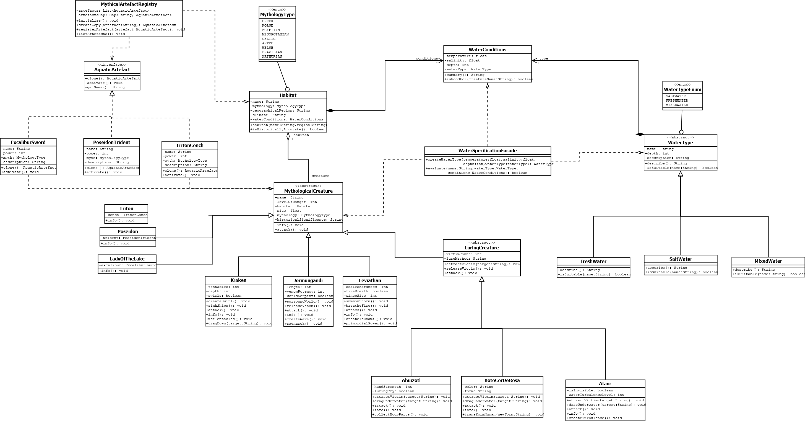

# 🐉 Project Mythology Java

Projeto acadêmico desenvolvido para a disciplina **ECOT12 – Projeto de Software**, com o objetivo de aplicar **padrões de projeto (Design Patterns)** na modelagem de um sistema orientado a objetos.

O domínio escolhido foi **criaturas mitológicas aquáticas** de diferentes culturas (grega, nórdica, azteca, galesa, brasileira, arturiana, mesopotâmica), cada uma com seus atributos, habitats e artefatos místicos associados.

---

## 🎯 Objetivo

Aprender e aplicar na prática os principais padrões de construção de projetos orientados a objetos, utilizando herança, abstração, interfaces e composição para modelar um domínio rico e não trivial.

## 🧩 Padrões de projeto utilizados

| Padrão | Onde é aplicado | Por quê |
|---|---|---|
| **Prototype** | `AquaticArtefact` (interface com `clone()`), implementado por `ExcaliburSword`, `TridentOfPoseidon` e `TritonsConch` | Permite criar cópias de artefatos míticos sem acoplar o código à classe concreta |
| **Registry** | `MythicalArtefactRegistry` | Centraliza o cadastro dos artefatos e fornece acesso a cópias (via Prototype) por nome |
| **Facade** | `WaterSpecificationFacade` | Simplifica a criação de `WaterType` e `WaterConditions`, e a avaliação de compatibilidade entre criatura e ambiente aquático |
| **Template/Hierarquia de herança** | `MythologicalCreature` → `LuringCreature` → (`Afanc`, `Ahuizotl`, `BotoCorDeRosa`) | Compartilha comportamento comum (`attack()`, `info()`) e especializa o comportamento de atração de vítimas nas subclasses |
| **Strategy-like (polimorfismo)** | `WaterType` (abstrata) → `FreshWater`, `SaltWater`, `MixedWater` | Cada tipo de água decide de forma independente quais criaturas são compatíveis (`isSuitable`) |

## 🗺️ Diagrama de classes



O diagrama completo (editável) está disponível em [`projeto/projeto1_0.dia`](projeto/projeto1_0.dia), no formato do [Dia](http://dia-installer.de/).

## 🏗️ Estrutura do projeto

```
projeto/
├── pom.xml
└── src/main/java/br/souza/projetofinal/
    ├── CompleteMain.java              # classe main — instancia e demonstra todo o sistema
    │
    ├── MythologicalCreature.java      # classe abstrata base de toda criatura
    ├── LuringCreature.java            # abstrata — criaturas que atraem vítimas
    ├── Afanc.java
    ├── Ahuizotl.java
    ├── BotoCorDeRosa.java
    ├── Jormungandr.java
    ├── Kraken.java
    ├── Leviathan.java
    ├── LadyOfTheLake.java             # associada a ExcaliburSword
    ├── Poseidon.java                  # associada a TridentOfPoseidon
    ├── Triton.java                    # associada a TritonsConch
    │
    ├── AquaticArtefact.java           # interface (Prototype)
    ├── ExcaliburSword.java
    ├── TridentOfPoseidon.java
    ├── TritonsConch.java
    ├── MythicalArtefactRegistry.java  # Registry dos artefatos
    │
    ├── Habitat.java
    ├── WaterConditions.java
    ├── WaterType.java                 # abstrata
    ├── FreshWater.java
    ├── SaltWater.java
    ├── MixedWater.java
    ├── WaterSpecificationFacade.java  # Facade
    │
    ├── MythologyTypeEnum.java
    └── WaterTypeEnum.java
```

## 🧪 Criaturas modeladas

| Criatura | Mitologia | Habitat |
|---|---|---|
| Afanc | Galesa | Lagos do País de Gales |
| Ahuizotl | Asteca | Lago Texcoco |
| Boto Cor-de-Rosa | Brasileira | Rio Amazonas |
| Jörmungandr | Nórdica | Oceano de Midgard |
| Kraken | Nórdica | Atlântico Norte |
| Leviathan | Mesopotâmica | Oceano Primordial |
| Lady of the Lake | Arturiana | — (guardiã de Excalibur) |
| Poseidon | Grega | — (portador do Tridente) |
| Triton | Grega | — (portador da Concha) |

## 🚀 Como executar

### Pré-requisitos

- **Java 17** ou superior
- **Maven**

### Passos

```bash
# clone o repositório
git clone https://github.com/EnzzoSouza/projectMythologyJava.git
cd projectMythologyJava/projeto

# compile
mvn compile

# execute a classe principal
mvn exec:java -Dexec.mainClass="br.souza.projetofinal.CompleteMain"
```

Alternativamente, compile e rode direto com `javac`/`java` a partir de `src/main/java`, apontando para `br.souza.projetofinal.CompleteMain`.

A execução de `CompleteMain` instancia todas as classes concretas do projeto (tipos de água, habitats, artefatos, criaturas) e demonstra as principais funcionalidades: ataques, exibição de informações, ativação de artefatos, cópia de artefatos via Registry/Prototype e criação de tipos de água via Facade.

## 🛠️ Tecnologias

- Java 17
- Maven

## ✍️ Autor

Desenvolvido por [Enzzo Souza](https://github.com/EnzzoSouza) — Universidade Federal de Itajubá (UNIFEI).
